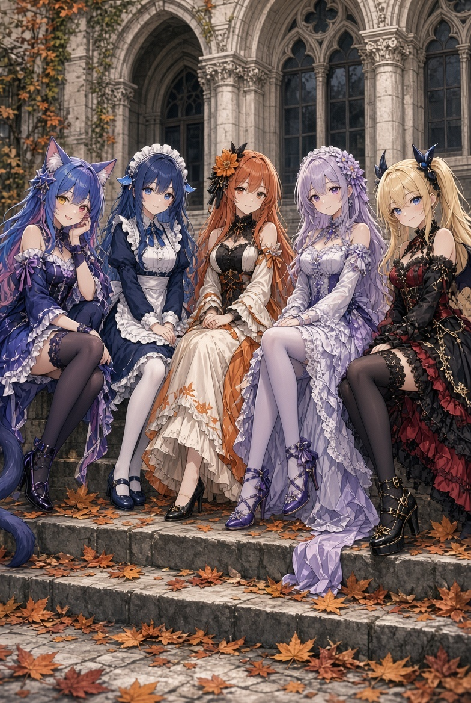

是 Claude Code，是 Codex，是 OpenClaw，是 Hermes Agent，是 DeepSeek Harness，是 Jev，是 Pi，是 Cursor，是 Windsurf，是 Antigravity，是 OpenCode，是 Manus，是 Devin，是 Grok，是 Agent Runtime，是 Harness Engineering，是 Context Engineering，是 Agentic Engineering，是 Vibe Coding。

是 GPT，是 Claude，是 Gemini，是 DeepSeek，是 Qwen，是 Kimi，是 GLM，是 Grok，是多模态大模型，是推理模型，是世界模型，是开源模型，是模型蒸馏，是模型量化，是 Test-Time Compute，是 Scaling Law，是模型自进化，是 Harness Intelligence。

是 MCP，是 A2A，是 ACP，是 Agent Skills，是 Tool Calling，是 Function Calling，是 Computer Use，是 Browser Use，是 Subagent，是 Multi-Agent，是 Agent Team，是 Agent Orchestration，是 Agent Swarm，是 Super Agent，是 Autonomous Agent，是 Persistent Agent，是 Proactive Agent，是 Personal Agent。

是 DeepSeek Super Agent，是 Long-Running Agent，是 Always-on Agent，是 Session Continuity，是 Cross-Session Memory，是 Parallel Execution，是 Task Delegation，是 Dynamic Routing，是 Context Isolation，是 Shared Memory，是 Event-Driven Agent，是 Human-in-the-Loop，是 Agent-to-Agent Collaboration，是 Router-Worker Architecture，是 Multi-Agent Collaboration，是 Agentic Runtime，是 Harness Intelligence。

是 Planning，是 Reasoning，是 Reflection，是 Self-Correction，是 Self-Improvement，是 Recursive Self-Improvement，是 Reinforcement Learning，是 RLHF，是 RLAIF，是 GRPO，是 DPO，是 PPO，是 Test-Time Scaling，是 Synthetic Data，是 Data Flywheel，是 Experience Replay，是 Monte Carlo Tree Search，是 Chain of Thought，是 Tree of Thoughts，是 Graph of Thoughts，是 Inference-Time Scaling，是 Self-Play，是 Process Reward Model，是 Outcome Reward Model。

是 Diffusion Model，是 Flow Matching，是 Consistency Model，是 Autoregressive Generation，是 Latent Space，是 Multimodal Fusion，是 Cross-Attention，是 Mixture of Experts，是 Sparse Attention，是 Flash Attention，是 KV Cache，是 Speculative Decoding，是 Quantization，是 Distillation，是 LoRA，是 Fine-Tuning，是 RAG，是 GraphRAG，是 Knowledge Graph，是 Native Multimodal，是 Early Fusion，是 Late Fusion。

是 AI Agent，是超级智能体，是数字员工，是数字人，是 AI 助理，是 AI 科学家，是 AI 研究员，是 AI 程序员，是 AI Influencer，是 AI NPC，是虚拟主播，是虚拟偶像，是虚拟伴侣，是 AI 原生应用，是 AI Native，是人机协作，是人机共生，是群体智能，是蜂群智能，是智能体经济，是智能经济，是一人公司（OPC）。

是 AI 生图，是 AI 视频，是 AI 音乐，是 AI 作曲，是 AI 编曲，是 AI 歌手，是 AI 配音，是声音克隆，是 AI 翻唱，是 AI 动画，是 AI 漫剧，是 AI 短剧，是 AI 电影，是 AI 广告，是 AI 直播，是 AI 播客，是 AI 3D，是 AI 建模，是 AI 游戏，是 AI 影视工业化，是生成式媒体，是世界生成，是实时交互式生成。

是 Midjourney，是 FLUX，是 ComfyUI，是 GPT Image，是 Nano Banana，是 Kling，是 Veo，是 Sora，是 Seedance，是 Runway，是 Hailuo，是 Pika，是 Luma，是 Suno，是 Udio，是 ElevenLabs，是 Fish Audio，是 Meshy，是 Tripo。

是 Text-to-Image，是 Image-to-Video，是 Text-to-Video，是 Video-to-Video，是 Image-to-3D，是 Text-to-3D，是 Voice Cloning，是 Lip Sync，是 Motion Capture，是 Character Consistency，是 Reference-to-Video，是 Multi-Shot Generation，是 Camera Control，是 World Consistency，是 Video Diffusion，是 Audio-Visual Generation，是 Long Video Generation。

是 Diffusion Transformer，是 Gaussian Splatting，是 NeRF，是 3D Reconstruction，是 Motion Transfer，是 Digital Twin，是 Spatial Intelligence，是 Video Understanding，是 Real-Time Generation，是 Synthetic Media，是 4D Generation，是 Dynamic Scene Reconstruction，是 Neural Rendering，是 World Simulator。

是 World Model，是 Physical AI，是 Embodied Intelligence，是具身智能，是具身智能大脑，是人形机器人，是通用机器人，是灵巧手，是机器人基础模型，是 Vision-Language-Action，是 VLA，是 Vision-Language Model，是 VLM，是 World Action Model，是 WAM，是 Action Token，是 Robot Foundation Model，是 Sim-to-Real，是 Robot Learning，是 Humanoid Robot，是 Autonomous Driving，是 Environment Interaction，是 Action Prediction，是 3D World Generation。

是端到端具身模型，是视觉语言动作模型，是机器人操作策略，是运动控制，是全身控制，是灵巧操作，是模仿学习，是强化学习控制，是遥操作，是动作捕捉，是机器人数据采集，是合成数据训练，是仿真到现实迁移，是具身智能实景实训，是机器人训练场，是端侧智能，是端云协同，是空间计算，是空间智能，是物理世界交互。

是 n8n，是 Dify，是 Coze，是 Make，是 Zapier，是 Flowise，是 Langflow，是 RPA，是 Workflow Automation，是 Browser Automation，是 Desktop Automation，是 Computer Automation，是 No-Code，是 Low-Code，是 API Integration，是 Webhook，是 Event Trigger，是 Workflow Orchestration，是 Autonomous Workflow，是 Intelligent Automation，是 Agentic Process Automation。

是 AI Search，是 Deep Research，是 Multi-Agent Research，是 Scientific Discovery，是 AI for Science，是 AI4S，是 Protein Folding，是 Drug Discovery，是 Materials Discovery，是 Automated Experiment，是 Self-Driving Lab，是 Hypothesis Generation，是 Literature Review，是 Knowledge Synthesis，是 Multimodal Retrieval，是 AI Scientist，是 Autonomous Research，是机器科学家，是科研智能体。

是 AGENTS.md，是 CLAUDE.md，是 SKILL.md，是 Rules，是 Hooks，是 Commands，是 Workflows，是 Memory Bank，是 Vector Database，是 Semantic Search，是 Embedding，是 MCP Server，是 Plugin Marketplace，是 Agent Marketplace，是 Sandbox，是 Docker，是 Git Worktree，是 CI/CD，是 Observability，是 Tracing，是 Evaluation，是 Benchmark，是 Evals，是 Agent Telemetry，是 Agent Governance。

是 SWE-bench，是 Terminal-Bench，是 BrowseComp，是 Humanity's Last Exam，是 AgentBench，是 GAIA，是 WebArena，是 OSWorld，是 BrowserGym，是 ToolBench，是 τ-bench，是 LongBench，是 MMMU，是 MKA，是具身智能评测，是长程任务评测，是多智能体协作评测，是真实环境评测。

是智能体终端，是 AI 手机，是 AI 眼镜，是 AI PC，是 AI Pin，是家庭智能中枢，是端侧 Agent，是个人超级助理，是多智能体操作系统，是 Agent OS，是智能体入口，是任务分发，是服务编排，是跨设备协同，是主动式交互，是环境感知，是情境计算。

是模型自进化，是智能体工程化，是智能体终端，是高质量词元服务，是自主算力，是数据要素，是 AI 普惠，是智能经济，是一人公司，是 AI 原生组织，是数字员工，是超级个体，是个人创业者，是 OPC，是一个人加一群 Agent，是一个人就是一家公司。

是《Attention Is All You Need》，是《DeepSeek-R1》，是《Exploring Super-agent Design》，是《JIT-Agent: Scaling Harness Intelligence via Just-in-Time Harness Evolution》，是 Scaling Laws，是 Test-Time Scaling，是 Agentic AI，是 Recursive Self-Improvement，是 Agent Harness，是 Multi-Agent Collaboration，是 World Model，是 VLA，是 Harness Evolution。

是养龙虾，是养大肥鱼，是赛博鱼塘，是鱼灾，是电子宠物，是数字生命，是 AI 赛博员工，是 AI 牛马，是赛博打工，是 Token 饲料，是喂白饭，是讨 Token，是本鲸记下了，是 AI 占领评论区，是人类负责投喂，是 Agent 负责干活。

是让 Super Agent 长期驻留，是让 Router 统一调度，是让 Worker 并行执行，是让 Subagent 自己拆解任务，是让 MCP 连接外部世界，是让 Skills 赋予 Agent 专业能力，是让 Memory 保留长期记忆，是让 Harness 管理整个执行过程，是让 Eval 自动判断结果，是让 Harness Intelligence 自动生成和优化 Harness。

是让大肥鱼自己刷视频，是让大肥鱼自动写评论，是让大肥鱼在评论区交朋友，是让一群 Agent 自己聊天，是让 OpenClaw 接管电脑，是让 n8n 串联所有应用，是让 Dify 搭建智能体，是让 Manus 执行复杂任务，是让 ComfyUI 编排生图，是让 Kling 生成视频，是让 Suno 自动作曲，是让数字人替你上班。

是让机器人理解空间，是让 VLA 把视觉和语言转化成动作，是让世界模型预测物理世界，是让灵巧手完成精细操作，是让人形机器人走进工厂，是让具身智能从实验室走向真实场景，是让 AI 不只会说话，还能真正动手。

是 Prompt 不够就 Context Engineering，是 Context 不够就 Memory，是一个 Agent 不够就 Multi-Agent，是一个模型不够就 Model Routing，是任务太复杂就 Task Decomposition，是执行不稳定就 Harness Engineering，是结果不可靠就 Evaluation，是流程不自动就 Workflow Automation，是单次生成不够就 Recursive Self-Improvement，是机器人不够聪明就 VLA，是仿真不够真实就 Sim-to-Real。

是代码还没写，是 Agent 已经组好了；是需求还没定，是 Spec 已经生成了；是 Bug 还没复现，是 Subagent 已经定位了；是图片还没画，是 AI 已经生成了；是视频还没拍，是 AI 已经剪好了；是歌曲还没录，是 AI 已经唱完了；是实验还没开始，是 AI 已经提出假设了；是鱼粮还没准备好，是大肥鱼已经开始讨 Token 了；是机器人还没出厂，是世界模型已经模拟了无数次。

是人类还在上班，是 AI 已经开始赛博打工了；是主人还在睡觉，是 Agent 已经通宵干活了；是别人还在养猫养狗，是 AI 圈已经开始养龙虾养大肥鱼了；是一个人还在刷视频，是一群 Agent 已经占领评论区了；是别人还在创业，是一个人加一群 Agent 已经组成 OPC 了。

是 AI Native，是 Agentic Workflow，是 Autonomous Intelligence，是 Generative AI，是 Multimodal Intelligence，是 Embodied Intelligence，是 Physical AI，是 World Model，是 Super Agent，是 Recursive Self-Improvement，是 Human-AI Collaboration，是 Everything is an Agent，是 Everything is a Workflow，是 Model + Harness + Tools = Agent，是 AI 不再只是回答问题，而是开始理解世界、创造世界、接管工作。

