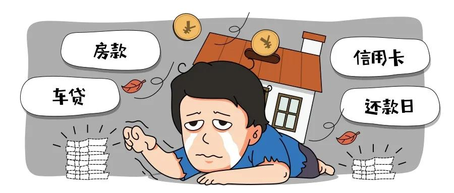
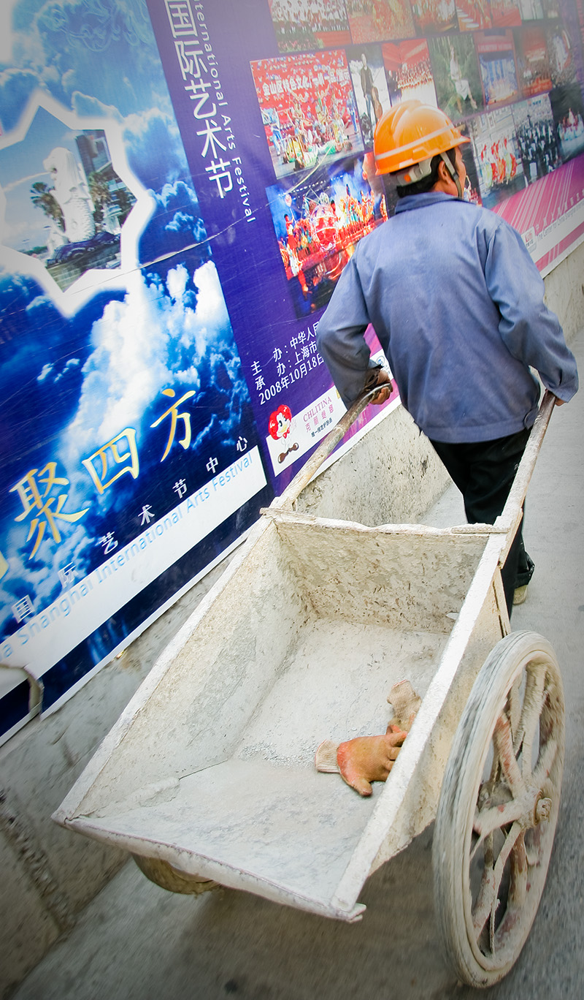

<!-- 配图通过公开网页检索后下载到本仓库，不使用外部图床。
房款、车贷与还款压力漫画：CSDN 文章配图
来源页面：https://blog.csdn.net/m0_53918927/article/details/127340695
原图：https://img-blog.csdnimg.cn/f1474f22fc834f2ead322ddf78367949.png
体力劳动照片：4wallz / Gordon B Wall，无水印原图，CC BY-SA 3.0
来源页面：https://commons.wikimedia.org/wiki/File:Chinese-manual-labor.jpg
原图：https://upload.wikimedia.org/wikipedia/commons/d/dd/Chinese-manual-labor.jpg
两图仅作主题示意，不据此推断照片人物的婚姻或债务状况。
-->

　　现在的婚礼，大多是一场自欺欺人的盛大表演。

　　越长大越发现，现在的婚礼，早已不是两个人幸福的开始，更像一场精心彩排、全程演给别人看的热闹骗局。

　　豪车是租的，婚纱是借的，漫天浪漫是干冰造的，就连那一刻的梦幻场景，都是临时搭建出来的。

　　婚礼结束，道具全部归还，人群一哄而散。第二天醒来，所有浮华清零，真实琐碎的生活，原样归来。

## 一、我们买下的，是一天的体面

　　我们花几万、甚至十几万办一场盛大婚礼，从来不是为了婚姻，只是为了那一天的体面。

　　车队要整齐，布景要高级，流程要拉满，照片要像电影。

　　明明心里知道，这些东西对往后日子毫无帮助，可没人敢简化、敢敷衍。

　　**因为所有人怕的不是婚礼不完美，是被别人看不起。**

　　最讽刺的，是人人追捧的豪华婚车车队。

　　平日里的我们，打车要比价，买菜要挑实惠，花钱精打细算，恨不得一分钱掰两半花。唯独结婚这天，死要面子。

　　一排豪车整整齐齐，全是租赁公司的。司机按小时计费，根本不认识新人，更不在乎你们的爱情故事。

　　车队慢悠悠压马路，堵在路上造成拥堵。车里的人还要端着姿态，假装人生圆满、风光登顶。

　　为了这短短几小时的虚假排面，很多年轻人，花光两三年所有积蓄。

　　婚庆搭建的高级背景、泡沫罗马柱、云雾氛围，看着华丽无比。婚礼一结束，全部变成一堆没人要的垃圾。

　　支撑这一切的，无非是普通人骨子里的攀比心。

　　别人结婚奔驰车队，你不敢用普通车；别人五星酒店大婚，你不敢简单家宴。

## 二、流水线上的感动，谁都不轻松

　　现在的婚礼感动，全是流水线的标准化套路，僵硬、刻意、又折腾人。

　　新娘凌晨三四点起床化妆，困到眼皮打架，也要强撑精致。一层层粉底盖住疲惫，却盖不住熬了整夜的憔悴。

　　堵门游戏万年不变，尴尬又繁琐。伴郎伴娘来回折腾，所有人忙到人仰马翻。

　　哪里是结婚，根本就是花钱给自己找罪受。

　　全程摄影师指挥、司仪控场：“新郎深情一点”“新娘低头温柔一点”“别笑太大牙”。

　　所有人都是提线木偶，没有情绪，没有心动，只有配合摆拍。

　　仪式进行到一半，没人顾得上爱不爱。心里想的全是：鞋藏哪了？还有多久结束？什么时候能吃口热饭？

## 三、你的人生首映，别人的一场吃席

　　你把这天当成人生高光首映、终身纪念。可在宾客眼里，这只是一场普通吃席。

　　台上，司仪煽情配乐拉满，新人哭得热泪盈眶、无比真诚。

　　台下，长辈聊家常、问礼金、比排场；年轻人喝酒打闹；小孩满地乱跑。

　　没人认真听你们的余生誓言。大家最关心的只有：菜新不新鲜、伴手礼好不好看、酒够不够档次。

　　一场婚礼，累垮两个家庭。父母掏空积蓄，忙前忙后熬得身心俱疲。

　　所有人全力以赴撑完一天的热闹，最后能被记住的，可能只是一句：今天菜有点咸。

## 四、热闹散了，账单才刚刚开始

　　曲终人散，最现实的一幕才刚刚开始。

　　婚纱小心翼翼归还，怕脏了要赔钱；豪车准时开走，奔赴下一场生意；上万的花艺布置，隔天全部进垃圾车。

　　唯独留给新人的，是透支的存款、待还的账单，和一夜褪去的虚假幸福。

　　卸完妆看着镜子里疲惫的自己，再看着一堆要还的尾款、信用卡、花呗，才发现热闹背后的代价。

　　很多人风光结完婚，接下来大半年、一整年，都在吃泡面、省开销、还债度日。

　　为了当一天万众瞩目的主角，把往后好几年的日子，过得捉襟见肘。

　　很多人误以为：婚礼越豪华，婚姻越稳固。

　　可现实很打脸。娱乐圈天价婚礼、世纪大婚数不胜数，该离婚的，照样一拍两散。

　　我们真的该问问自己：这场倾尽所有的盛大仪式，到底是办给自己幸福的，还是演给外人看的？

## 五、把钱和真心，留给往后的日子

　　真正的新婚纪念，根本不需要重金堆砌。

　　两家人简单吃顿家常菜，团圆热闹，踏实温暖。两个人去看海、爬山、短途旅行，留下独属于彼此的回忆。

　　**真实的陪伴，永远比摆拍的照片更动人。**

　　太多年轻人，被商家“一生只有一次”的话术洗脑。误以为：没有大钻戒、没有豪车、没有豪华酒店，这场婚就结得丢人、结得不完整。

　　可婚姻真正的底气，从来不在婚礼当天，而在往后几十年的烟火日常。

　　豪车带不走生活烦恼，婚纱遮不住性格棱角，排场撑不起余生安稳。

　　真心建议所有准备结婚的年轻人：婚礼能简则简。

　　省下几万块的虚耗开支，带父母旅行，尽尽孝心，不好吗？用来布置小家、换舒适床垫、添实用家电，让日子过得安稳，不好吗？

　　放下虚荣的攀比，放下别人的眼光。好好过日子，远比好好演戏更重要。

　　人生最精彩的不是婚礼几小时的舞台表演，是往后三餐四季、岁岁年年的平凡生活。

　　别为了一天看起来很值钱，让往后余生过得廉价又拮据。

　　所有道具会归还，所有排场会消散，所有热闹会落幕。

　　**灯光熄灭、宾客散尽之后，那个陪你早起晚睡、吃剩菜、扛房贷、渡低谷、接纳你所有普通和狼狈的人，才是这一生最珍贵的资产。**
